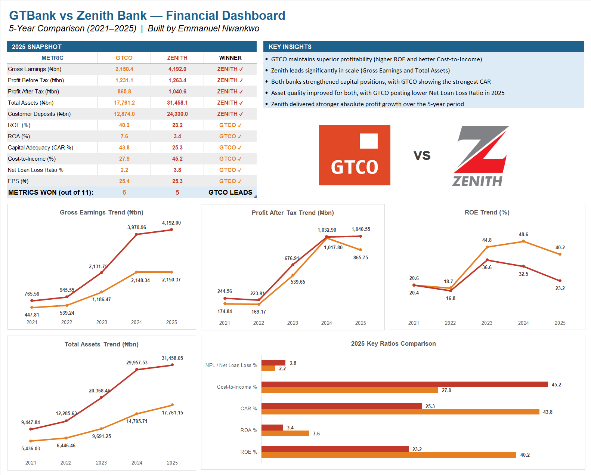

# GTBank vs Zenith Bank — 5-Year Financial Analysis

A data-driven comparison of Nigeria's two biggest banks 
using audited annual reports from 2021 to 2025.

## Dashboard Preview

## What This Analysis Covers

| Category | Metrics |
|---|---|
| Income Statement | Gross Earnings, PBT, PAT, EPS, DPS |
| Balance Sheet | Total Assets, Deposits, Loans, Equity |
| Profitability | ROE, ROA, PAT Margin, PBT Margin |
| Efficiency | Cost-to-Income Ratio |
| Capital & Risk | CAR, Net Loan Loss Ratio |

## Key Finding

Zenith Bank is 77% larger than GTCO by total assets.
Yet GTCO delivers a significantly higher Return on Equity 
(40.2% vs 23.2% in 2025) and a far better Cost-to-Income 
ratio (27.9% vs 45.2%).

Bigger does not always mean better run.

## Data Sources

- GTCO Annual Reports 2021–2025: gtcoplc.com
- Zenith Bank Annual Reports 2021–2025: zenithbank.com
- All figures extracted from audited Group financial statements

## How to Use

1. Download the Excel file
2. Go to Dashboard tab for the visual comparison
3. Go to Data Entry tab to see all raw figures and sources

## About

Built by Emmanuel Nwankwo

GitHub: github.com/Emmapluz

LinkedIn: linkedin.com/in/emmanuel-uchenna-nwankwo
